# gobgp on NixNet

A [NixNet](https://github.com/birneee/nixnet) environment for the OBGP fork of
GoBGP ([Stinktopf/gobgp, branch `master`](https://github.com/Stinktopf/gobgp/tree/master)):
the BAD GADGET topology of that fork's own lab, one `gobgpd` per router in its
own Linux network namespace, and a scenario that shows whether the routers
settle on a stable best path.

Everything is pinned through Nix: the daemon, the topology, the addresses, the
configuration files and the measurement. One command runs the whole thing, no
containers, no daemon, no root.

## Usage

```sh
nix run .              # OBGP (GOBGP_OPERA_ENABLED=true)
nix run .#bgp          # plain GoBGP, same topology and scenario, for comparison
nix run . 1-5          # five runs into out/01 … out/05
nix build .#mermaid-svg --no-link --print-out-paths   # diagram; see Topology for installing it
```

Requirements: Linux with namespaces, Nix with `flakes` and `nix-command`.
The OBGP daemon is built from the fork at the revision `flake.lock` pins
(`nix build .#gobgp` gives just the binaries).

## Topology

Four routers in four ASes, one eBGP session per pair (six links, three sessions
per router, one point-to-point link each). The router IDs, ASNs, and the cyclic
preference that makes this topology a BAD GADGET come from
[`gobgp-lab/topologies/bad-gadget.yaml`](https://github.com/Stinktopf/gobgp/blob/master/gobgp-lab/topologies/bad-gadget.yaml):
frankfurt prefers routes learned from fulda, toronto those from frankfurt, fulda
those from toronto. `aachen` originates the observed prefix.

Link order, interface names, and addresses are derived from the topology at
evaluation time (`nixnet.nix`): the links sorted by name get `10.10.<n>.0/24`,
the lexicographically smaller router of a pair `.1`, the larger `.2`.

| interface | link | subnet | addresses |
|---|---|---|---|
| `e1` | aachen – frankfurt | 10.10.1.0/24 | aachen .1, frankfurt .2 |
| `e2` | aachen – fulda | 10.10.2.0/24 | aachen .1, fulda .2 |
| `e3` | aachen – toronto | 10.10.3.0/24 | aachen .1, toronto .2 |
| `e4` | frankfurt – fulda | 10.10.4.0/24 | frankfurt .1, fulda .2 |
| `e5` | frankfurt – toronto | 10.10.5.0/24 | frankfurt .1, toronto .2 |
| `e6` | fulda – toronto | 10.10.6.0/24 | fulda .1, toronto .2 |

ASNs: frankfurt 65001, toronto 65002, fulda 65003, aachen 65004; router IDs
10.0.0.1 … 10.0.0.4.



The diagram is the experiment's own view of the network: `nix build .#mermaid-svg`
renders it from the same configuration the experiment runs (`nix build .#mermaid`
gives the mermaid source as text). It is byte-identical to `assets/topology.svg`
under this flake's pin (mermaid-cli 11.17.0; the render is deterministic, a
rebuild from the same inputs produces the same bytes), and it differs from
nixnet's `mkMermaidSvg` in one point: labels are rendered with `htmlLabels` off,
so they are `<text>` elements and survive GitHub's SVG sanitizer (which strips
`<foreignObject>`).

To refresh it:

```sh
install -m0644 "$(nix build .#mermaid-svg --no-link --print-out-paths)" assets/topology.svg
```

Do that through the flake, not with a bare `mmdc`: mermaid measures text in the
browser inside the build sandbox, so a hand-run of the same `mmdc` version
produces different geometry (viewBox 1696×290 instead of 1651×282).

## What the experiment does

For every router, `nixnet.nix` renders a `gobgpd.conf` (global ASN and router
ID, one `[[neighbors]]` block per link with `ipv4-unicast`, a `policy-definition`
per preferred neighbor that sets the local preference, and the import policy
apply block) — the same configuration shape the fork's Kubernetes controller
generates for its lab.

Each node then runs two scripts:

1. `daemon` (background): starts `gobgpd` with that configuration, the gRPC API
   on `127.0.0.1:50051`, and `GOBGP_OPERA_ENABLED` set to the variant under
   test.
2. `main` (awaited): waits until all of the router's sessions report `Establ`,
   lines all routers up on the same wall-clock instant, lets `aachen` originate
   the prefix two seconds later, and samples its own best path for that prefix
   every 250 ms for 30 s.

Active and passive roles are fixed by ASN (as in the fork's controller): the
router with the higher ASN waits (`passive-mode`), the other one connects.

A testbed script `report` waits for all routers, then prints one row per
router: number of samples, number of best-path changes, number of distinct best
paths, Loc-RIB size for the observed prefix (minimum / average / maximum over
the samples in which the prefix is present, and how many those are), and the
path sequence.

A stable router has `changes = 1`, the single change from "prefix not known yet"
to its path. More changes mean the router's best path keeps flipping, i.e. the
topology is oscillating.

The metric is the first path of the router's Loc-RIB for the prefix: GoBGP
keeps the Loc-RIB sorted most preferred first, and OBGP keeps the standard
order, so that entry is the local best path. (The `best` flag in the gRPC
`ListPath` response is not populated in this fork, so the position, not the
flag, identifies the path.)

### Observed runs

Both variants, same topology, `nix run .#bgp` and `nix run .` on a single
machine, with the daemon from the revision `flake.lock` pins:

```
plain GoBGP: best path and Loc-RIB size for 10.99.0.0/24, sampled every 0.25s over 30s
router      samples  changes  states paths min/avg/max  known  path (last | distinct, in order)
aachen          116        1       2      1/   1.0/    1    108  0.0.0.0 | - | 0.0.0.0
frankfurt       116       60       4      1/   2.1/    3    108  10.10.4.2 65003 65002 65004 | - | 10.10.4.2 65003 65002 65004 | 10.10.1.1 65004 | 10.10.4.2 65003 65004
fulda           116       71       4      1/   2.1/    3    108  10.10.2.1 65004 | - | 10.10.2.1 65004 | 10.10.6.2 65002 65004 | 10.10.6.2 65002 65001 65004
toronto         116       73       4      1/   1.8/    3    108  10.10.3.1 65004 | - | 10.10.3.1 65004 | 10.10.5.1 65001 65004 | 10.10.5.1 65001 65003 65004

OBGP: best path and Loc-RIB size for 10.99.0.0/24, sampled every 0.25s over 30s
router      samples  changes  states paths min/avg/max  known  path (last | distinct, in order)
aachen          117        1       2      1/   1.0/    1    109  0.0.0.0 | - | 0.0.0.0
frankfurt       117        1       2      1/   1.0/    1    109  10.10.1.1 65004 | - | 10.10.1.1 65004
fulda           117        1       2      1/   1.0/    1    109  10.10.2.1 65004 | - | 10.10.2.1 65004
toronto         117        1       2      1/   1.0/    1    109  10.10.3.1 65004 | - | 10.10.3.1 65004
```

Plain GoBGP never settles: the path via the preferred neighbor is re-advertised
with a growing AS path until it is refused as a loop and withdrawn, which hands
the routers back to the direct path, which is again outranked by the preferred
neighbor. OBGP keeps exactly one path per Loc-RIB and converges on the direct
path (AS path `65004`, one hop).

## Reading the output

The run writes everything under the work directory (`out/00` by default, the
run index increments if the directory exists):

| file | content |
|---|---|
| `<router>/gobgpd.conf` | the configuration the daemon was started with |
| `<router>/neighbor.log` | last `gobgp neighbor` dump, sessions and counters |
| `<router>/rib.log` | one line per sample: timestamp, paths in the Loc-RIB, next hop, AS path of the best path |
| `<router>/rib-raw.log` | the first `gobgp global rib` dump, in text form |
| `<router>/done` | marker written after the last sample |

## Adapting

- **Topology**: edit `topology.nix` (same shape as the lab's YAML: `asn`,
  `routerId`, `neighbors` with `peerAs` and optional `localPref`). Addresses,
  interfaces and all configuration files follow automatically. Neighbor
  relations must be symmetric; the flake asserts it.
- **Scenario**: the sampling window and the observed prefix are arguments of
  `nixnet.nix` (`originPrefix`, `sampleDuration`, `sampleInterval`), as are the
  BGP timers (`holdTime`, `keepaliveInterval`, `connectRetry`). The flake
  instantiates it twice, once per variant.
- **Interactive**: add a foreground script to a node to get a shell inside its
  namespace, e.g. `nodes.frankfurt.scripts.shell = { exec = "bash"; foreground = true; };`

## Notes

- The environment exercises the control plane. `gobgpd` only programs the
  kernel FIB with zebra/FRR configured, which this environment does not set up,
  so the announced prefix is not pingable; the measurement is the best path in
  each Loc-RIB. Add static routes via `networking.interfaces.<if>.ipv4.routes`
  if you want forwarding too.
- OBGP applies to IPv4/IPv6 unicast only, rejects `AS_SET` and confederations,
  and does not support Add-Path export or route server mode; the fork's README
  lists the four GoBGP tests that fail with OBGP enabled by design.
- `gobgpd` needs to bind port 179; nixnet sets `ip_unprivileged_port_start=0`
  inside the nodes, so no root is required.
